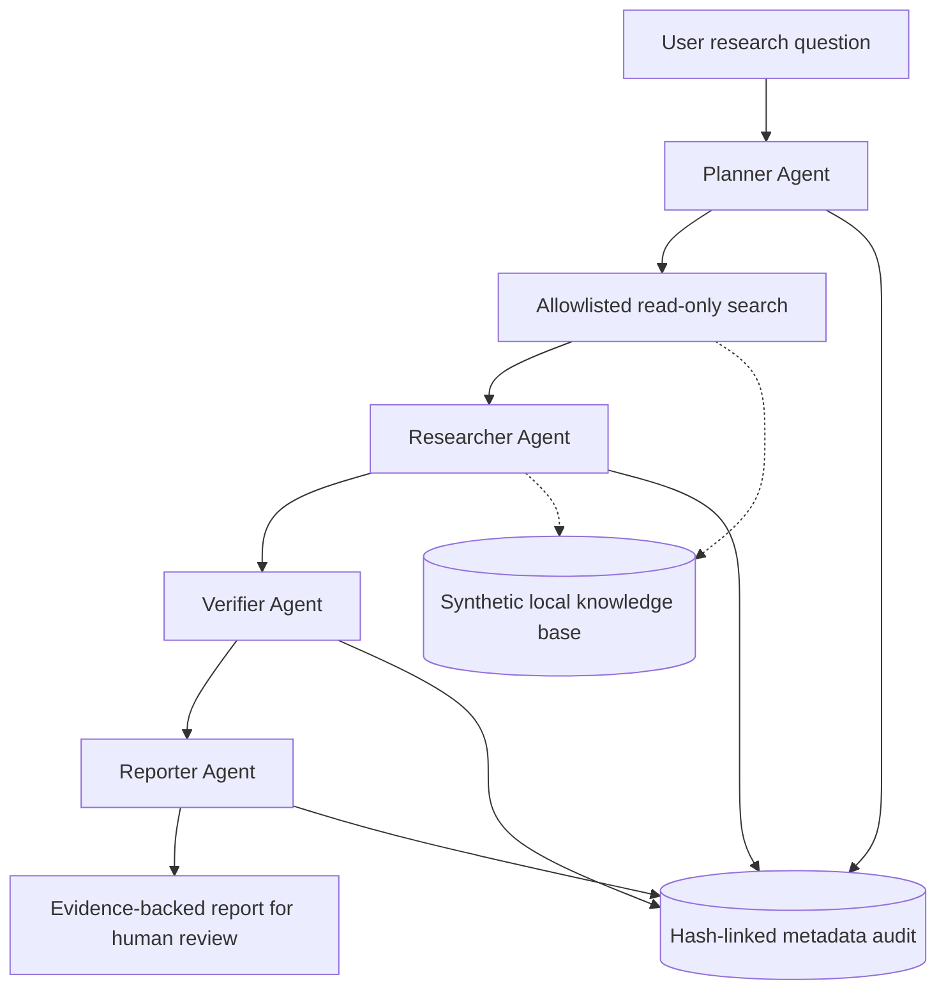

# Agent Forge Lab

[](https://github.com/Mikario22/Agent-Forge-Lab/actions/workflows/ci.yml)

**Evidence-grounded multi-agent AI orchestration** · Python 3.11+ · Offline-first · 48 automated tests

Agent Forge Lab is a personal engineering portfolio project demonstrating **four distinct role-based agents**, a **read-only tool registry**, **bounded handoffs**, **evidence verification**, **auditability**, and an **optional model-backed mode** using the OpenAI Responses API. All included documents and examples are synthetic.

> This project is a controlled research prototype, **not** an autonomous production agent or a verified fact-checking system. It cannot disable users, edit resources, execute shell commands, send messages, or approve sensitive actions. The optional model is disabled by default.

## Architecture



| Agent | Responsibility | Permitted outputs |
|---|---|---|
| **Planner** | Selects up to three bounded lexical search queries | `queries[]` |
| **Researcher** | Uses allowlisted local search/read tools, proposes quotations | `candidates[{document_id,quote}]` |
| **Verifier** | Checks admissible, exact-source-quote candidates and chooses which to retain | `accepted_claim_ids[]` |
| **Reporter** | Selects and orders verified claims | `selected_claim_ids[]` |

Even with a model, **all factual report lines are assembled deterministically from exact source quotations** and tagged with document IDs. An arbitrary model-suggested ID, tool name or free-form unsupported claim cannot become a final statement.

### What counts as verified?

A claim passes an **exact text match** against a locally retrieved document. That proves only that the quoted words appeared in that selected document—it does **not** prove the source is truthful, the quotation is representative, the model interpreted it correctly, or that an action is authorized. Treat all reports as material for human review.

## Quick start — offline, no credentials required

```powershell
py -m venv .venv
.\.venv\Scripts\python.exe -m pip install -e .
.\.venv\Scripts\python.exe -m unittest discover -s tests -v
.\.venv\Scripts\python.exe -m agent_forge_lab run samples/synthetic_kb.json --question "Summarize login investigations and approved maintenance" --output report.json
```

macOS/Linux:

```bash
python -m pip install -e .
python -m unittest discover -s tests -v
python -m agent_forge_lab run samples/synthetic_kb.json --question "Summarize login investigations and approved maintenance" --output report.json
```

The included synthetic example generates a report that cites documents such as `INC-101` and `INC-102` and records independent agent handoffs. It makes **0 network/API calls**. Output includes an audit hash chain, source IDs, rejected-proposal count and a human-review status.

## Optional real-model operation

The code includes a genuine adapter to `POST https://api.openai.com/v1/responses`. In this mode, each of the four agents makes a **separate model call** using a role-specific instruction and typed proposal; strict application-side validators and read-only tools remain authoritative. The model is not permitted to call external tools or invent final report prose.

**Only use fabricated or explicitly approved-to-share data. External API requests may incur charges.** No keys should ever be committed.

```powershell
$env:OPENAI_API_KEY = "<your-api-key>"
$env:AGENT_FORGE_MODEL = "<model-available-to-your-API-project>"
py -m agent_forge_lab run samples/synthetic_kb.json --question "Summarize login investigations and approved maintenance" --provider openai --allow-external-data-transfer --output report.json
```

An available model ID must be supplied by you; the project does not assume your account has access to a particular model. API integration is **mock-tested**, but an actual paid external model call has **not** been performed as part of this portfolio build. Model-generated proposals that fail schema or citation validation fail closed or are excluded.

API documentation: [OpenAI Responses API](https://platform.openai.com/docs/api-reference/responses).

## Safety and limits

- **Tool allowlist:** only `search_documents` and `read_document`. No shell, browser, network retrieval or writes in the workflow.
- **Bounded execution:** at most three search queries and a configurable total tool-call limit (default 8); up to five retained claims.
- **Evidence controls:** only exact quotes from retrieved documents; unknown IDs and invented quotes cannot be published as verified claims.
- **Independence:** the Verifier and Reporter can only select already validated claim IDs. Model suggestions are non-authoritative proposals.
- **Audit:** each role/tool transition writes a metadata-only SHA-256 hash-chain entry. This detects accidental changes but is **not cryptographically authenticated** against an adversary who can rewrite the entire chain.
- **No persistence or privilege:** in-memory per-run state, no cross-run memory, no production connections, no automated remediation or approvals.
- **Prompt injection:** documents are treated as untrusted input, not instructions; however, this design does not prove resistance to every adversarial document or model failure. Always review outputs.

## Development

```bash
python -m unittest discover -s tests -v
```

CI runs the tests on Python **3.11, 3.12 and 3.13** and performs an offline end-to-end smoke test. All tests use synthetic data and mock external model responses.

## Roadmap

- [x] Four-role offline orchestration and task handoffs
- [x] Optional model-backed role proposals over the Responses API
- [x] Read-only tool allowlist, budgets, verified source quotes and audit
- [x] CI tests, synthetic knowledge base and offline example
- [ ] Run live model smoke test using authorized synthetic data and an API key
- [ ] Add pluggable authorized data connectors and identity/role enforcement
- [ ] Build task queue, checkpoint persistence and parallel independent review
- [ ] Add multi-agent quality benchmarks and prompt-injection adversarial suite
- [ ] Add a reviewer dashboard with human approvals (still no direct remediation)

**Repository:** [Mikario22/Agent-Forge-Lab](https://github.com/Mikario22/Agent-Forge-Lab).